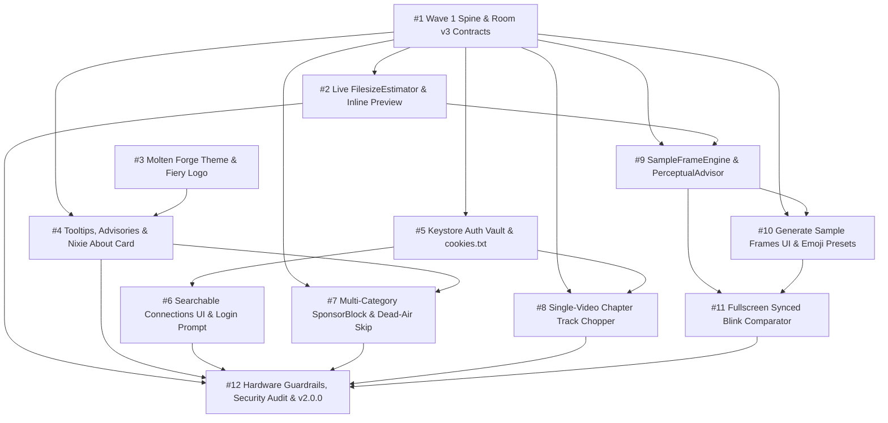

# Redfur Forge v2.0 Architecture Roadmap

> Grounded multi-wave engineering blueprint converting the **Redfur Forge Feedback Document** into incremental, dogfoodable GitHub releases (`v1.3.0` → `v1.4.0` → `v1.5.0` → `v2.0.0`) on [`EchoTiger/redfur-forge`](https://github.com/EchoTiger/redfur-forge).

---

## 1. Feedback-to-Issue Traceability Matrix

| Feedback Section | Request Summary | Wave & Release | GitHub Issue | Primary Role(s) |
| :--- | :--- | :--- | :--- | :--- |
| **Spine / Architecture** | Shared contracts, Room v3 presets DB, host-device capability profiler | **Wave 1 (`v1.3.0`)** | [#1](https://github.com/EchoTiger/redfur-forge/issues/1) | `role:spine-architect` |
| **QoL #1 + Interface #4** | Universal live filesize estimates + inline tap-to-compare compress preview | **Wave 1 (`v1.3.0`)** | [#2](https://github.com/EchoTiger/redfur-forge/issues/2) | `role:media-engine`, `role:ui-artisan` |
| **Interface #1 + #2** | Molten Forge vs Arc-Relay visual coding, glows/strobes + fiery Forge Fissal logo | **Wave 1 (`v1.3.0`)** | [#3](https://github.com/EchoTiger/redfur-forge/issues/3) | `role:ui-artisan` |
| **Interface #3 + Extra #1, #2** | Contextual `(?)` tooltips, hardware advisories & Nixie-fuse Echo & Fissal About card | **Wave 1 (`v1.3.0`)** | [#4](https://github.com/EchoTiger/redfur-forge/issues/4) | `role:ui-artisan` |
| **Internal Function #1 (Engine)** | Android Keystore cookie vault, Auth WebView bridge, `cookies.txt` import & `YtDlpEngine` auth trap | **Wave 2 (`v1.4.0`)** | [#5](https://github.com/EchoTiger/redfur-forge/issues/5) | `role:platform-auth` |
| **Internal Function #1 (UI + Note)** | Pre-populated searchable dropdown w/ icons, `Check`/`Re-auth`/`Remove`, private-media login prompt | **Wave 2 (`v1.4.0`)** | [#6](https://github.com/EchoTiger/redfur-forge/issues/6) | `role:ui-artisan`, `role:platform-auth` |
| **Interface #5** | Multi-category SponsorBlock + FFmpeg dead-air / silence skipping w/ tooltips | **Wave 2 (`v1.4.0`)** | [#7](https://github.com/EchoTiger/redfur-forge/issues/7) | `role:media-engine` |
| **Interface #6** | Single-video multi-song chapter detection & individual track/audio-vs-video chopper | **Wave 2 (`v1.4.0`)** | [#8](https://github.com/EchoTiger/redfur-forge/issues/8) | `role:media-engine`, `role:platform-auth` |
| **QoL #2 (Engine)** | Multi-config Sample Frame Generator + Perceptual "Best Config" Pareto knee advisor | **Wave 3 (`v1.5.0`)** | [#9](https://github.com/EchoTiger/redfur-forge/issues/9) | `role:media-engine` |
| **QoL #2 (Menu & Presets)** | Generate Sample Frames menu (timestamp, Random, Original toggle) + Emoji Format Presets | **Wave 3 (`v1.5.0`)** | [#10](https://github.com/EchoTiger/redfur-forge/issues/10) | `role:ui-artisan` |
| **QoL #2 (Comparator)** | Fullscreen Blink Comparator: L/R single-tap tab swap, locked `(X, Y, Zoom)`, long-press vote/remove | **Wave 3 (`v1.5.0`)** | [#11](https://github.com/EchoTiger/redfur-forge/issues/11) | `role:ui-artisan` |
| **Extra #1 + Final Release** | Device RAM/CPU/storage guardrails, OOM/security audit, full regression QA & signed `v2.0.0` | **Wave 4 (`v2.0.0`)** | [#12](https://github.com/EchoTiger/redfur-forge/issues/12) | `role:qa-gatekeeper` |

---

## 2. Dependency & Parallelism Graph

Issue **#1** stabilizes the shared data spine (`PipelineSpec`, `ResolvedLinkModels`, Room `v3` `FormatPresetEntity`, `DeviceCapabilityAdvisor`) so parallel workers across Waves 1–3 never collide on database migrations or serialization fields.

---

## 3. Release Milestones (`v1.3.0` → `v2.0.0`)

Because **v1.2.0** already ships the in-app **GitHub Releases Self-Updater**, every signed wave tag pushed to GitHub (`v1.3.0`, `v1.4.0`, `v1.5.0`, `v2.0.0`) becomes immediately installable straight inside Redfur Forge on Pixel hardware:

1. **Milestone 1 (`v1.3.0`) — Wave 1: Spine, Molten Forge Identity & Live Estimators** (`#1`–`#4`)
2. **Milestone 2 (`v1.4.0`) — Wave 2: Authenticated Vault, Chapter Chopper & Smart Audio** (`#5`–`#8`)
3. **Milestone 3 (`v1.5.0`) — Wave 3: Sample Frame Lab, Synced Comparator & Emoji Presets** (`#9`–`#11`)
4. **Milestone 4 (`v2.0.0`) — Wave 4: Hardware Guardrails, Full QA & v2.0 Launch** (`#12`)

---

## 4. Multi-Agent Concurrency & Worktree Guardrails

To prevent file-clobbering, Gradle daemon lock contention, and broken merges while running multiple autonomous agents:

1. **Shared Spine First**: Never spawn parallel Wave 1 feature slices until Issue `#1` (`PipelineSpec.kt`, `ResolvedLinkModels.kt`, `ForgeDatabase.kt`) is merged and unit-tested on `main`.
2. **Isolated Worktrees per Parallel Implementer**: Each parallel author MUST execute inside its own `git worktree` / `workspace: "share"` branch (`feat/issue-<n>-<slug>`) rather than editing the primary working tree concurrently.
3. **Serialized Central File Wire-Up**: Hot files (`ForgeViewModel.kt`, `SettingsScreen.kt`, `HubScreen.kt`, `StudioEditorScreen.kt`) should either have mutually exclusive new component composables merged sequentially into them or be owned by one integrator during Wave assembly.
4. **No Concurrent Gradle Builds in the Same Directory**: Only run `./gradlew` inside an agent's own isolated worktree (`--no-daemon` when verifying in CI/worktrees so zombie daemons do not pin RAM).
5. **Mandatory Adversarial Gate**: Every PR / branch must pass review against its GitHub Issue checklist (`role:qa-gatekeeper`) before closing the issue and cutting the wave release tag.

---

> Detailed role prompts, boundary matrices, and QA verification templates live in [`docs/AGENT_PLAYBOOK.md`](./docs/AGENT_PLAYBOOK.md).
